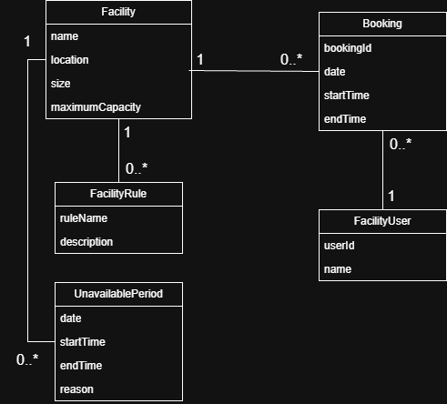

# 3 Requirements modelling

# 3.1 Use Case Diagram

# 3.2 One Use Case Narrative

## Use case / ID

Use case: UC01 — ID: FR02 Make Booking

## Primary actor / goal

Primary Actor: Facility user, the person attempting to reserve a facility / Goal: Successfully reserve an available sports facility for a selected date and time

## Preconditions / trigger

Preconditions: The user must be an authorised user to make a booking. Trigger: The facility user chooses to begin a new booking.

## Main successful flow

1. Facility User: Begins the process of making a new booking (FR02)
2. Facility User: Chooses a facility, date and time (FR02)
3. System: Checks the availability for that facility and period also checking existing bookings (FR01, FR03)
4. System: Reviews if the requested booking follows the facility specific rules (FR11)
5. System: Shows the booking details for the user to view. (FR02)
6. Facility User: Submits the booking requests with the information that is required (FR02)
7. System: Checks the submission and records the booking making sure there is no conflict or rule violation. (FR02, FR03, FR11)
8. System: Displays the booking outcome and allows the user to know if the reservation was made (FR02)

## Alternative / exception flows

### 3a – facility unavailable (FR03)

- If the facility is already booked for the selected date and time the system will inform that specific date and time is not available and the user can then book for
- another date and time and no booking record is created of this unfinished booking

### 4a - Facility restriction (FR11)

- If the requested booking does not follow the facility specific rules the system will inform the user that the request doesn’t meet with that specific facility rules. The
- booking will only continue if the user adjusts their booking to follow the specific rules or cancel the attempt. No invalid booking is created

### 7a – Booking Submission timeout (NFR06)

- If the booking submission times out, the system will inform the user that the booking status needs to be checked again and the user should only retry when the system
- determines if the booking was successfully recorded or not before allowing another submission. This prevents creating a duplicate booking

## Outcome / postconditions

**Successful Outcome:** The booking is created for the selected facility, date and time and that period is no longer available so there are no conflicting reservations.

**Unsuccessful outcome:** No new booking is created if the request fails the required checks or the user abandons it. A timeout must be resolved before the attempt is 
treated as failed.

## Related requirements

1. FR01 – checks facility availability
2. FR02 – allows the users make bookings
3. FR03 – Prevents overlapping bookings
4. FR11 Checks facility-specific booking restrictions.
5. NFR06 Handles submission timeouts and prevents bookings being duplicated

# 3.3 Activity Diagram

.png>)

# 3.4 Conceptual UML Class Diagram

